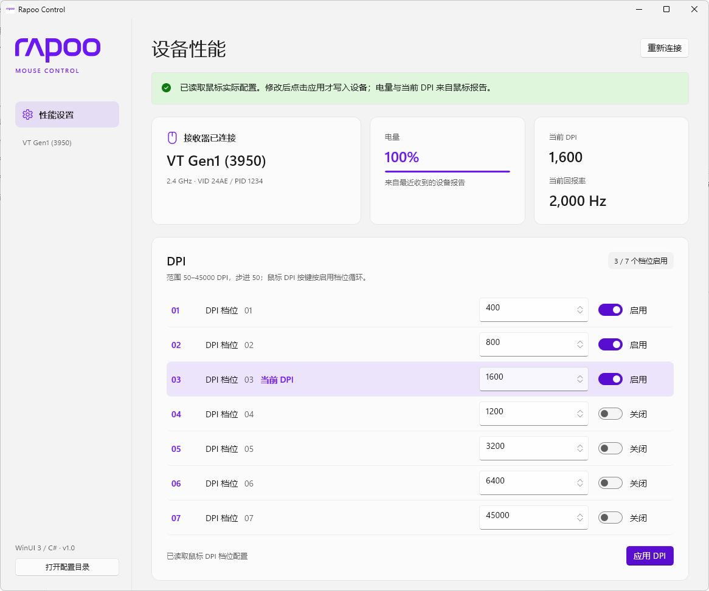
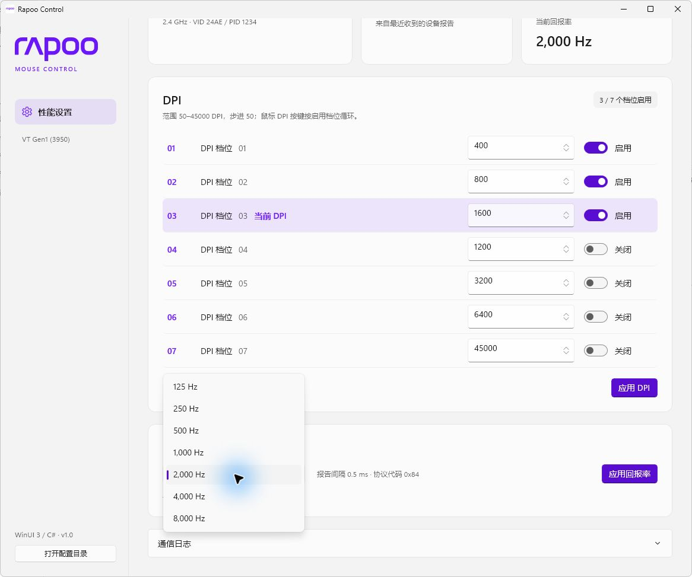

# Rapoo Control

为 **雷柏 VT1 Air Max** 提供简洁的 Windows 鼠标设置界面，使用 C# / WinUI 3 开发，通过 2.4 GHz USB 接收器读取和调整设备配置。

这是一个非官方工具，目前适配的设备为 VT1 Air Max（界面显示为 `VT Gen1 (3950)`）。其他型号、有线及蓝牙模式尚未验证。

[下载安装](https://github.com/RealManShao/rapoo-winui3/releases) · [开始使用](#开始使用) · [开发与构建](docs/DEVELOPMENT.md) · [设备协议](docs/PROTOCOL.md)

## 功能

- **DPI 档位**：设置 7 个档位，范围 50–45000 DPI，步进 50；每档可独立启用或关闭，至少保留一档。
- **独立 X/Y DPI**：分别设置两个方向的灵敏度，切回联动时使用 X DPI 同步 Y DPI；应用前不更改设备。
- **传感器与响应**：移动同步、直线/波纹修正、玻璃追踪、0.7 / 1 / 2 mm LOD、独立按下/抬起去抖、5–120 分钟休眠和 -30°–30° 角度。
- **回报率**：支持 125、250、500、1000、2000、4000、8000 Hz，应用后读回设备配置确认。
- **设备状态**：显示电量、当前 DPI 和设备配置的回报率，高亮匹配当前 DPI 的已启用档位。
- **按需应用**：连接时读取鼠标已有配置，编辑后点击对应的“应用”按钮才写入设备。
- **轻量运行**：不在后台定时轮询设备状态，不采集鼠标移动输入；通信日志仅在内存保留最近 128 条不同记录。

## 程序截图

连接设备后的实际界面，展示电量、当前 DPI 与七档 DPI 设置：

查看回报率选项

## 下载与安装

**系统要求：** Windows 10 2004（内部版本 19041）或更新版本，包括 Windows 11；仅支持 x64。

1. 前往 [Releases](https://github.com/RealManShao/rapoo-winui3/releases)，下载 `RapooControl-<版本号>-Setup-x64.exe`，无需下载源码。
2. 运行安装程序，按提示完成安装。缺少运行依赖时，安装器会从微软下载 .NET 10、Visual C++ 和 Windows App Runtime，期间可能需要管理员授权。
3. 从开始菜单打开 **Rapoo Control**。默认安装目录为 `%LOCALAPPDATA%\Programs\RapooControl`。

依赖齐全时可离线安装；需要补装依赖时请保持联网。若 Releases 暂无安装包，可以按[开发文档](docs/DEVELOPMENT.md)从源码构建。

## 开始使用

1. 插入鼠标的 **2.4 GHz USB 接收器**，开启并唤醒鼠标。
2. 启动程序，等待自动连接并读取现有配置；连接失败时点击右上角的“连接设备”重试。
3. 在 DPI 区域修改数值和档位开关，再点击“应用 DPI”。鼠标的 DPI 按键会在启用的档位间循环。
4. 在回报率下拉框中选择所需频率，再点击“应用回报率”，查看读回确认结果。
5. 修改传感器与响应设置后点击对应的应用按钮。读取失败的区域会保持禁用，重新连接可重试。

“分别编辑 X / Y DPI”控制两个方向的编辑方式；关闭时将当前 X 值复制给 Y，点击“应用 DPI”后才写入。重新连接时根据设备两张 DPI 表是否相同显示编辑方式。

电量和当前 DPI 来自鼠标最近一次主动上报。初次连接后显示 `—` 时，请先唤醒鼠标并等待上报。界面中的“当前回报率”是设备配置值，程序不测量鼠标输入的实际频率。

## 常见问题

### 找不到设备或配置读取失败

确认正在使用已适配的 2.4 GHz 接收器，尝试重新插拔、唤醒鼠标，然后点击连接按钮重试。连接成功后按钮显示为“重新连接”。同时插入多个匹配接收器时，请先只保留一个。

读取配置失败时，编辑区会保持禁用，避免用未知的配置覆盖设备。需要排查时，可展开窗口底部的“通信日志”，并在 [Issues](https://github.com/RealManShao/rapoo-winui3/issues) 中提供型号、连接方式、Windows 版本、问题描述及相关日志。

### 为什么应用 DPI 后，档位编号发生了变化？

设备会将启用的档位存放在前面。程序写入后重新读取配置，因此关闭部分档位后，显示顺序会随设备存储顺序调整。

### 为什么多个档位同时标记为“当前 DPI”？

鼠标上报当前 DPI 数值，不提供档位编号。若多个已启用档位设置了相同 DPI，它们都会被高亮。

### 用其他软件修改设置后，界面没有更新？

点击“重新连接”读取最新配置。程序只在连接和应用设置时读取配置，不在后台持续刷新。

### 安装失败时在哪里查看日志？

查看 `%LOCALAPPDATA%\RapooControl\installer-prerequisites.log`，处理网络或运行库安装问题后重试。若提示需要重启，请先完成重启。

## 开发与反馈

- [开发与构建](docs/DEVELOPMENT.md)：开发环境、调试、检查程序、发布目录及安装包构建。
- [设备协议](docs/PROTOCOL.md)：HID 报文、DPI / 回报率编码、设备状态解析和抓包依据。
- [原始抓包](wireshark/)：用于核对和复现协议的 USBPcap 数据。
- [提交问题或功能建议](https://github.com/RealManShao/rapoo-winui3/issues)。
